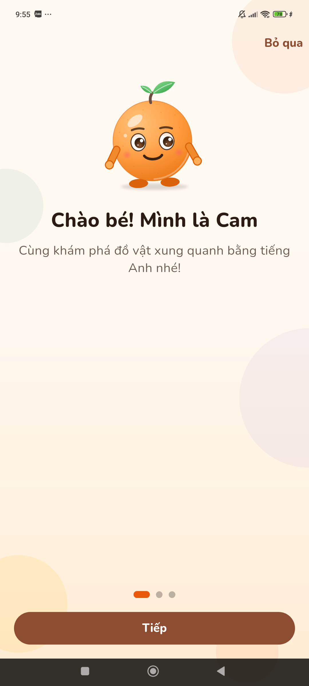
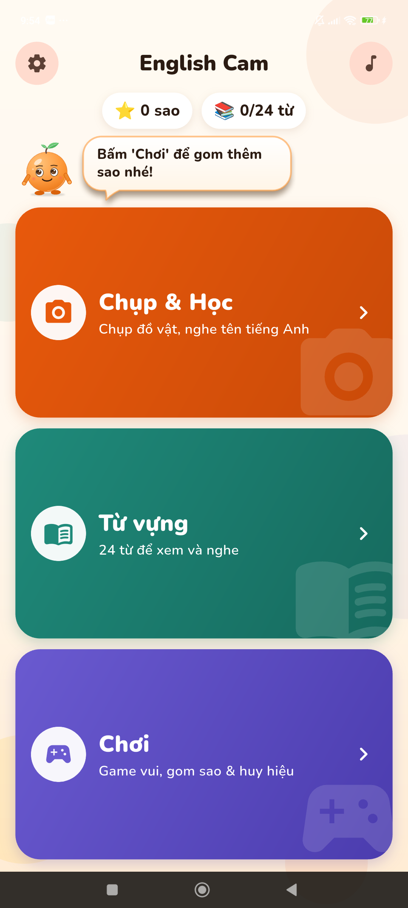
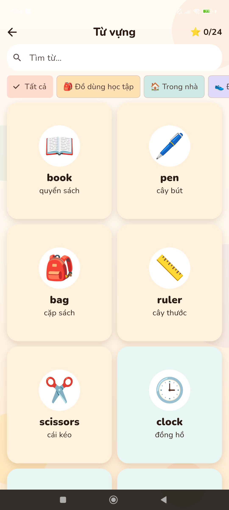
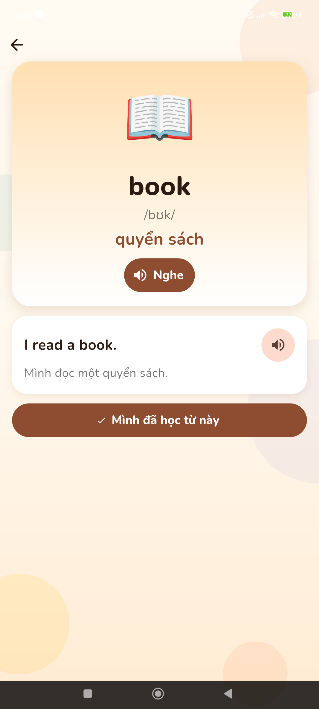
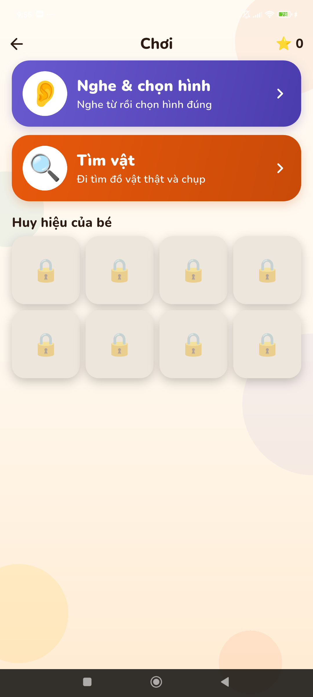
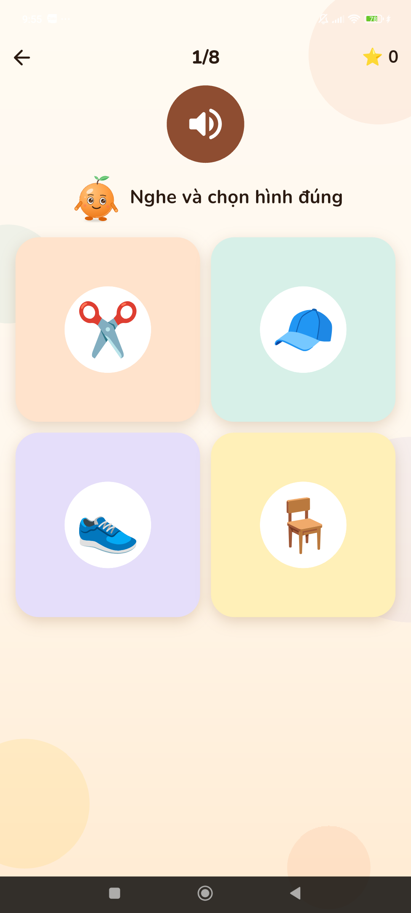
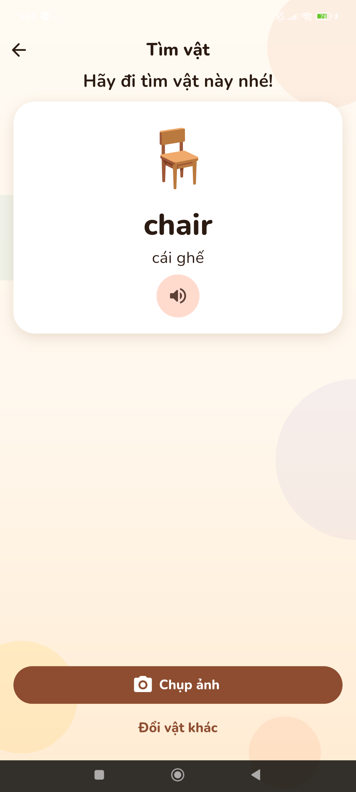

# English Cam

Ứng dụng Android giúp trẻ em học từ vựng tiếng Anh bằng camera: bé chụp một đồ vật, app nhận ra đó là gì, đọc tên bằng tiếng Anh, rồi bé học tiếp qua thẻ từ và game. Chạy **hoàn toàn offline**, không quảng cáo, không thu thập dữ liệu.

| Chào bé | Màn hình chính | Từ vựng | Chi tiết từ |
|---|---|---|---|
|  |  |  |  |

| Chơi | Nghe & chọn hình | Tìm vật |
|---|---|---|
|  |  |  |

*(Ảnh chụp trên Xiaomi 23021RAAEG, bản release.)*

## Tính năng

- **Chụp & Học:** chụp đồ vật → nhận diện trong ~0,2 giây → tự đọc từ tiếng Anh → vẽ khung vuông quanh vật. Nếu app nhận sai, bé hoặc bố mẹ bấm "Không đúng?" để chọn lại trong top-3.
- **Từ vựng:** 24 từ (phiên âm, nghĩa tiếng Việt, câu ví dụ có đọc), tìm kiếm, lọc theo chủ đề, đánh dấu đã học.
- **Game:** *Nghe & chọn hình* (8 câu/ván) và *Tìm vật* (đi tìm vật thật rồi chụp). Có sao và 8 huy hiệu. Trả lời sai chỉ được khuyến khích, không bị trừ sao.
- **Cam:** linh vật tự vẽ, lâu lâu hiện ra nhắn bé ở mọi màn hình (xem [docs/MASCOT.md](docs/MASCOT.md)).
- **Dành cho bố mẹ:** Cài đặt nằm sau cổng phụ huynh (phép nhân), có tắt nhạc, tắt lời nhắn của Cam, xoá tiến độ, xem lại hướng dẫn.

## 24 từ nhận diện được

`book, pen, bag, ruler, scissors, clock, cup, bottle, chair, table, bowl, spoon, shoe, hat, glasses, umbrella, toothbrush, towel, apple, banana, orange, ball, teddy_bear, toy_car`

## Cách chạy

Yêu cầu: Flutter 3.41+ (Dart 3.11+), Android SDK, thiết bị Android 7.0+ (API 24) hoặc emulator.

```bash
flutter pub get
flutter run                       # chạy bản debug trên thiết bị đang cắm
flutter build apk --release       # APK release: build/app/outputs/flutter-apk/app-release.apk
```

> APK release hiện ký bằng khoá debug mặc định của Flutter, chỉ để cài thử, **chưa** dùng để phát hành lên cửa hàng.

## Kiểm thử

```bash
flutter analyze                          # phân tích tĩnh
flutter test                             # 46 test đơn vị + widget
dart run tool/check_assets.dart          # nhãn model ↔ vocab ↔ ảnh ↔ âm thanh ↔ lời nhắn
flutter test integration_test -d <máy>   # đo độ chính xác và thời gian trên thiết bị thật
```

Kết quả đo trên thiết bị thật và hạn chế đã biết: xem [docs/TEST_REPORT.md](docs/TEST_REPORT.md).

## Mô hình nhận diện

- MobileNetV2 (fine-tune từ ImageNet), phân loại ảnh 24 lớp, file `assets/ml/model.tflite` (2,5 MB) và `labels.txt`.
- Input `[1,224,224,3]` float32, pixel giữ nguyên 0–255 (model tự `Rescaling` bên trong); output `[1,24]` softmax.
- Ngưỡng hiển thị kết quả: xác suất ≥ 0,7; thấp hơn thì Cam nói "Mình chưa chắc, thử chụp lại nhé!".
- Chạy bằng `tflite_flutter` trong isolate riêng, 2 luồng CPU.
- **Khung quanh vật:** model chỉ phân loại cả ảnh, không có bounding box. App ước lượng vị trí bằng cách cho model xem khoảng 24 ô vuông ở 3 cỡ, gộp xác suất thành bản đồ nhiệt rồi vẽ khung vuông quanh vùng nóng ([object_localizer.dart](lib/ml/object_localizer.dart)). Đây là ước lượng, khung có thể lệch hoặc rộng hơn vật.

## Cấu trúc

```
lib/
  main.dart                  # khởi động, nạp dữ liệu, màn hình lỗi khởi động
  core/                      # theme, bảng màu, router, widget dùng chung
  data/                      # VocabRepository, huy hiệu
  ml/                        # ClassifierService, tiền xử lý ảnh, ObjectLocalizer
  services/                  # âm thanh, tiến độ học, sao & huy hiệu, cài đặt
  features/                  # home, camera, result, vocab, game, mascot, onboarding, settings
assets/
  ml/  vocab/  audio/  game/  mascot/  fonts/
tool/                        # check_assets.dart, generate_audio.py
integration_test/            # đo độ chính xác và thời gian trên thiết bị thật
docs/                        # MASCOT.md, TEST_REPORT.md, ảnh màn hình
```

Toàn bộ từ vựng nằm trong `assets/vocab/vocab.json`, huy hiệu trong `assets/game/badges.json`, lời nhắn của Cam trong `assets/mascot/messages.json`: sửa nội dung không cần đụng code.

## Quyền riêng tư

Không cần mạng. Ảnh bé chụp chỉ được xử lý trên máy và không lưu lại hay gửi đi. Tiến độ học (từ đã học, sao, huy hiệu) lưu cục bộ bằng `shared_preferences`. Quyền duy nhất: **Camera**.

## Nguồn và giấy phép

| Thành phần | Nguồn |
|---|---|
| Giọng đọc từ và câu ví dụ | TTS của macOS (`say`, giọng Samantha), tạo bằng `tool/generate_audio.py`. **Nên thay bằng giọng thu thật nếu phát hành thương mại.** |
| Nhạc nền và hiệu ứng | Tự tổng hợp bằng sóng sin (`tool/generate_audio.py`) |
| Phông chữ | Nunito, SIL Open Font License 1.1 (`assets/fonts/OFL.txt`) |
| Hình minh hoạ từ vựng | Emoji của hệ thống (tạm thời); hai từ `table`, `towel` chưa có emoji nên hiện chữ cái đầu |
| Nhân vật Cam | Nhóm tự vẽ bằng code |
| Mô hình | MobileNetV2 fine-tune trên bộ ảnh của nhóm (project ML riêng, không nằm trong repo này) |

## Giai đoạn phát triển

Mỗi giai đoạn nằm trên một nhánh git: `phase-a-camera` → `phase-b-model` → `phase-c-vocab` → `phase-d-audio` → `phase-e-game` → `phase-f-ux` → `phase-f2-polish`; `main` luôn là bản mới nhất. Kế hoạch gốc: [PLAN.md](PLAN.md).
