# English Cam — Kịch bản demo trên máy ảo Pixel 7

Tài liệu ghi lại một lượt chạy thử toàn bộ chức năng của app English Cam (Flutter) kết nối backend ASP.NET Core thật, trên **máy ảo Android Pixel 7** (Android 17, API 37, arm64) chạy trên Mac. Ảnh trong tài liệu là ảnh chụp thật từ máy ảo ngày 2026-10-30, nằm trong [docs/demo/](demo/).

> Phạm vi: đã chạy thật trên máy ảo — cổng đăng nhập, đăng ký/OTP, hồ sơ bé, giới hạn thời gian, từ vựng, 2 game, camera + nhận diện, cài đặt, cập nhật từ vựng, dashboard phụ huynh, liên kết máy thứ hai, khu quản trị. **Chưa chạy được:** Google Sign-In (xem mục 9) và máy thật Android (chỉ có máy ảo + một iPhone). Các mục 1 đến 12 chạy với backend local; **mục 13 chạy lại luồng chính trên URL deploy** (kể cả email OTP thật).

## 0. Môi trường và cách chạy lại

| Thành phần | Giá trị |
|---|---|
| Máy ảo | `Pixel_7` (1080×2400, 420 dpi, Android 17 / API 37.2, arm64) |
| Backend | ASP.NET Core 8 chạy local `http://localhost:5080`, SQL Server 2022 trong Docker (cổng 1434), EF migrations |
| App | bản debug, `--dart-define=API_URL=http://10.0.2.2:5080` (10.0.2.2 = máy Mac nhìn từ máy ảo) |
| Camera máy ảo | webcam của Mac (nên model nhận ra theo cảnh thật trước webcam) |
| Mã OTP | backend chưa cấu hình SMTP nên **in mã ra console**; kịch bản đọc mã từ log |

```bash
# 1) Backend (cần Docker Desktop đang chạy)
cd english-cam-api
docker compose up -d
dotnet run --no-launch-profile --urls http://0.0.0.0:5080     # tự áp migrations; Admin seed: admin@englishcam.local

# 2) Máy ảo + app
emulator -avd Pixel_7 &
cd ../english-cam-app
flutter run -d emulator-5554 --dart-define=API_URL=http://10.0.2.2:5080
# (không cần PACK_URL: gói từ vựng mặc định lấy từ <API_URL>/api/pack/)

# 3) Điều khiển/chụp màn hình bằng adb (cách các ảnh dưới đây được tạo ra)
adb exec-out screencap -p > shot.png
adb shell input tap X Y          # bấm
adb shell uiautomator dump       # lấy toạ độ và nhãn của các nút (Flutter có cây accessibility)
```

Mã OTP lấy từ log của backend (dòng `SMTP chưa cấu hình. Email tới …: … là 123456`). Mật khẩu hợp lệ: ≥ 8 ký tự, có chữ thường và số.

---

## 1. Bắt buộc đăng nhập (cổng đăng nhập)

Chưa có phiên nào (không phụ huynh, không bé) thì chỉ thấy màn chào; app bên dưới không bấm được. Có hai lối vào: **Bố mẹ: đăng nhập / đăng ký** và **Máy của bé: nhập mã liên kết**.

| 1.1 Màn chào (cổng) | 1.2 Đăng ký: mật khẩu yếu | 1.3 Form đăng ký |
|:-:|:-:|:-:|
| 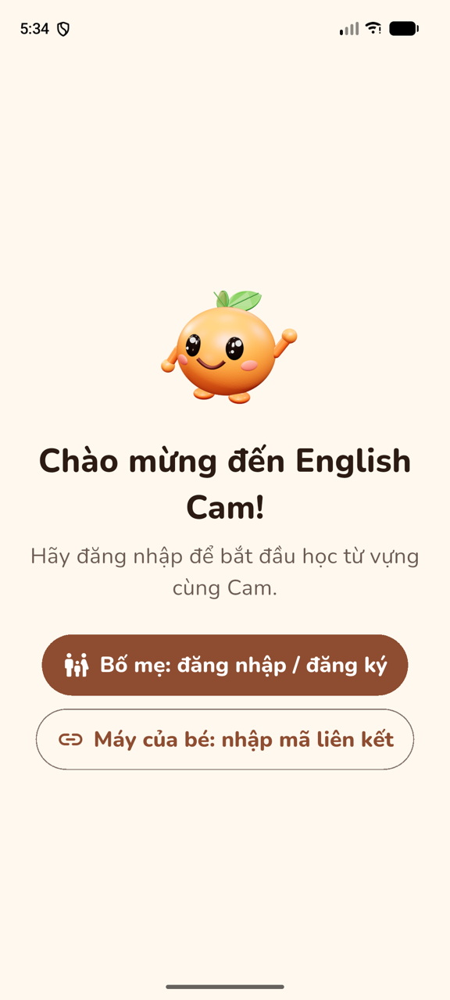 | 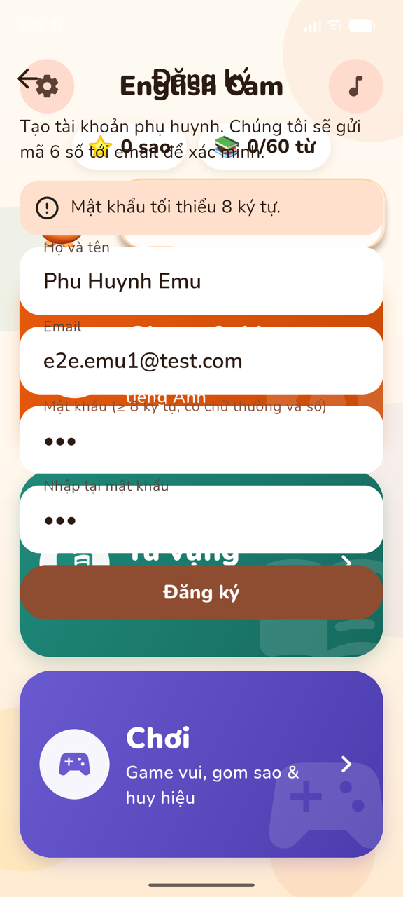 | 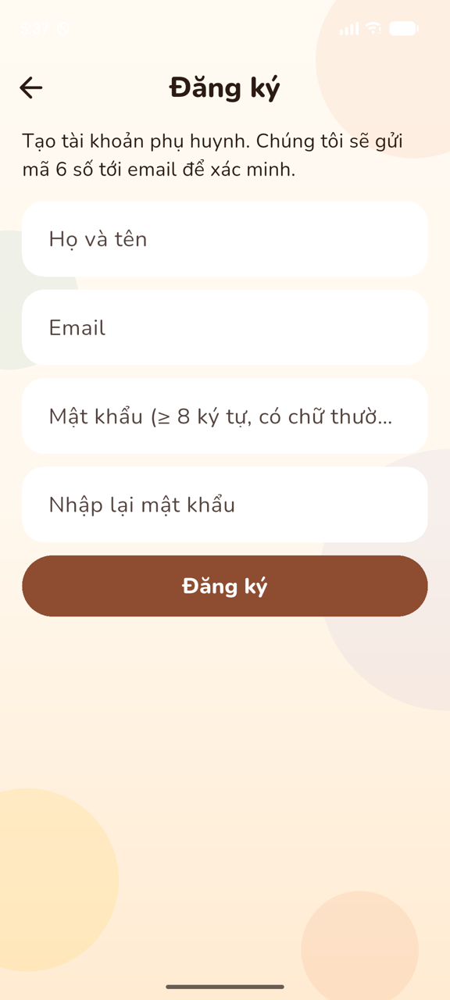 |

| 1.4 Nhập OTP | 1.5 Vào "Hồ sơ của bé" |
|:-:|:-:|
| 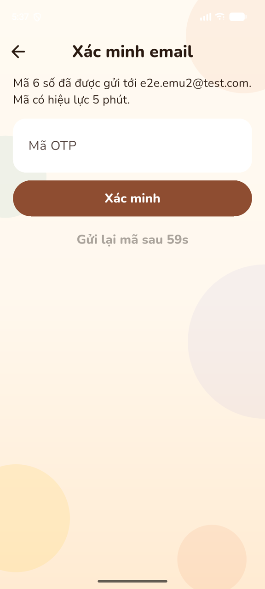 | 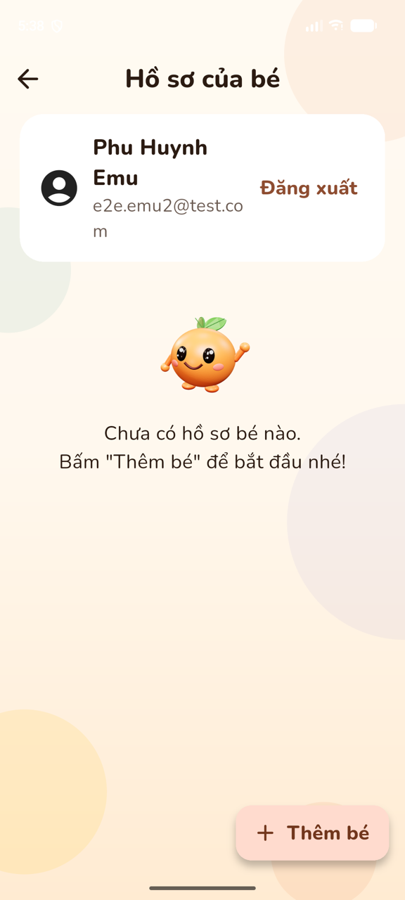 |

| Bước | Kết quả mong đợi | Kết quả thực tế |
|---|---|---|
| Mở app khi chưa đăng nhập | Thấy màn chào, không vào được Home | Đạt (1.1) |
| Bấm nút Back ở màn đăng nhập / nhập mã | Lùi về màn chào; ở màn chào thì thoát app | Đạt (đã sửa lỗi, xem mục 10) |
| Đăng ký, mật khẩu `abc` | Báo "Mật khẩu tối thiểu 8 ký tự." | Đạt (1.2) |
| Đăng ký, nhập lại mật khẩu không khớp | Chặn trước khi gọi máy chủ | Chỉ kiểm bằng test tự động (`account_flow_test`); không chụp trên máy ảo |
| Đăng ký hợp lệ → màn OTP | Hiện bộ đếm "Gửi lại mã sau 57s" | Đạt (1.4) |
| OTP sai `000000` | Báo "OTP sai hoặc hết hạn", ở lại màn OTP | Đạt |
| OTP đúng | Cổng biến mất, vào "Hồ sơ của bé" | Đạt (1.5) |
| Đăng nhập lại bằng email + mật khẩu + OTP | Như trên | Đạt |

## 2. Hồ sơ bé và giới hạn thời gian chơi

Phụ huynh thêm bé (biệt danh + hình đại diện), rồi ở **Quản lý** bật *Giới hạn thời gian chơi* và đặt 5 phút/ngày.

| 2.1 Thêm bé | 2.2 Danh sách bé | 2.3 Bật giới hạn | 2.4 Đã lưu 5 phút/ngày |
|:-:|:-:|:-:|:-:|
| 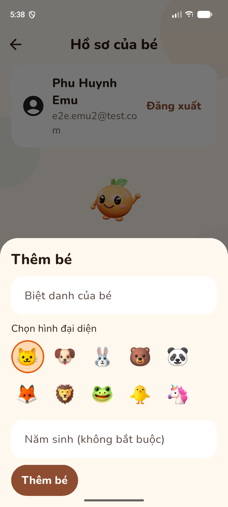 | 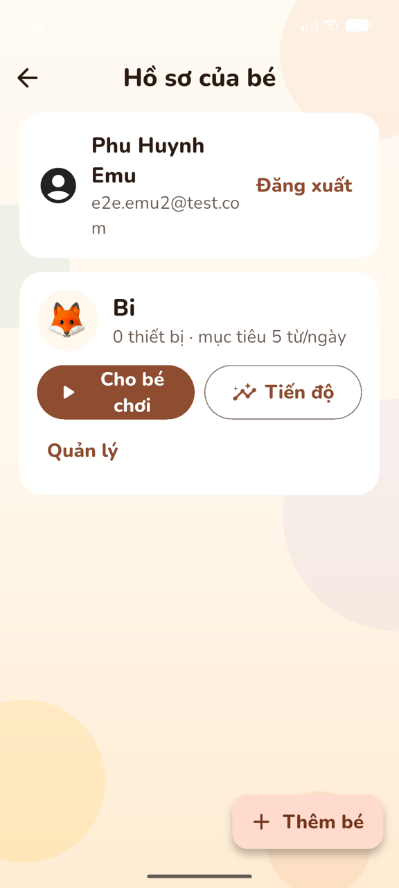 | 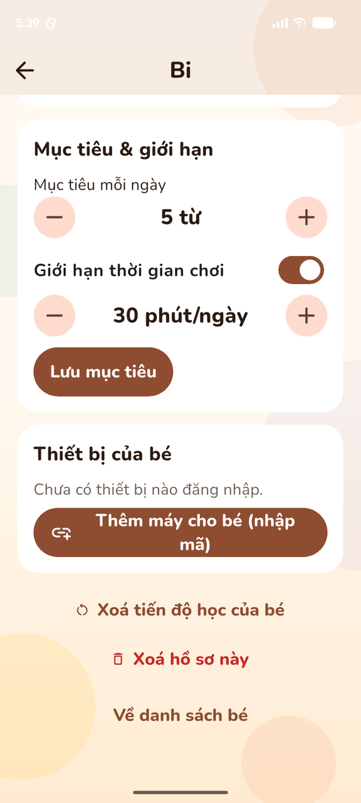 | 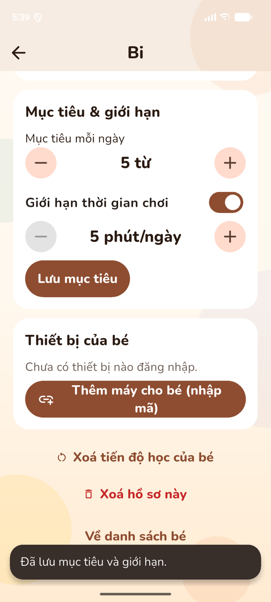 |

Kết quả: tạo bé "Bi" (🦊) thành công, thẻ bé hiện "0 thiết bị · mục tiêu 5 từ/ngày"; giới hạn điều chỉnh từ 30 xuống 5 phút và lưu được.

## 3. Bé học và chơi

Bấm **Cho bé chơi** để máy ảo vào chế độ bé (máy chủ cấp phiên role Child cho thiết bị này).

| 3.1 Home của bé | 3.2 Từ vựng | 3.3 Chi tiết từ |
|:-:|:-:|:-:|
| 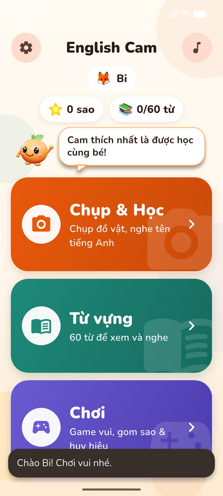 | 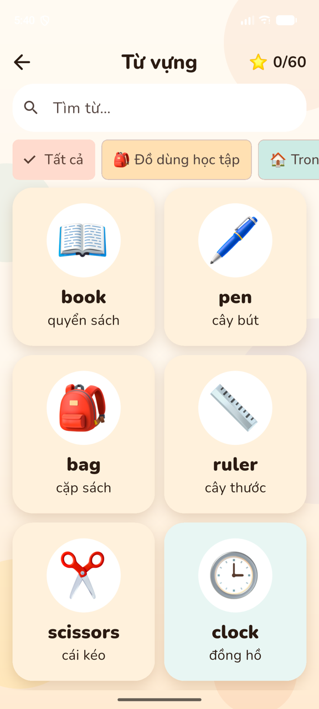 | 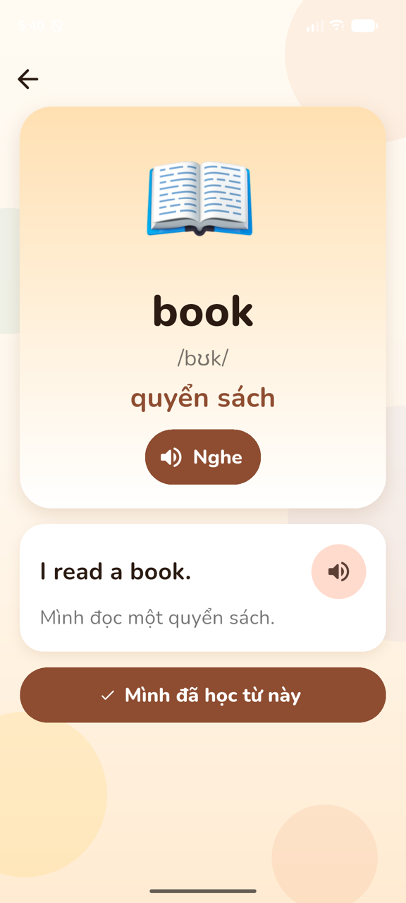 |

| 3.4 Trung tâm game | 3.5 Nghe & chọn hình | 3.6 Chọn sai |
|:-:|:-:|:-:|
| 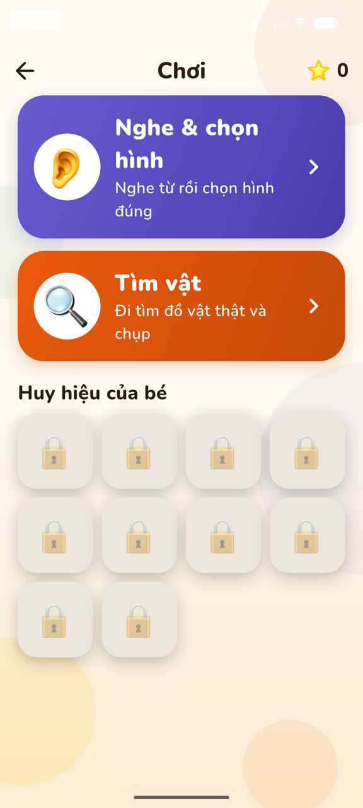 | 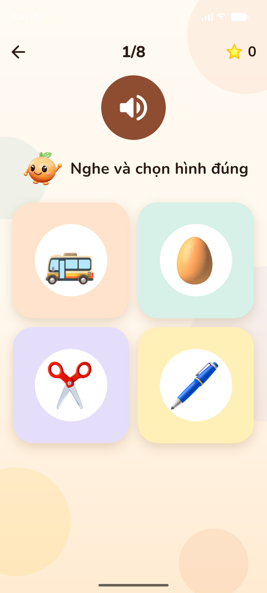 | 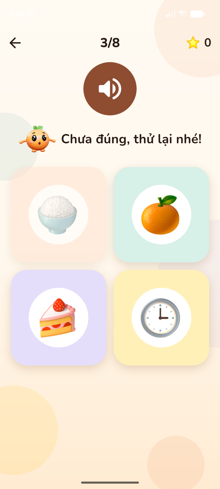 |

| 3.7 Huy hiệu mới | 3.8 Tổng kết ván | 3.9 Tìm vật |
|:-:|:-:|:-:|
| 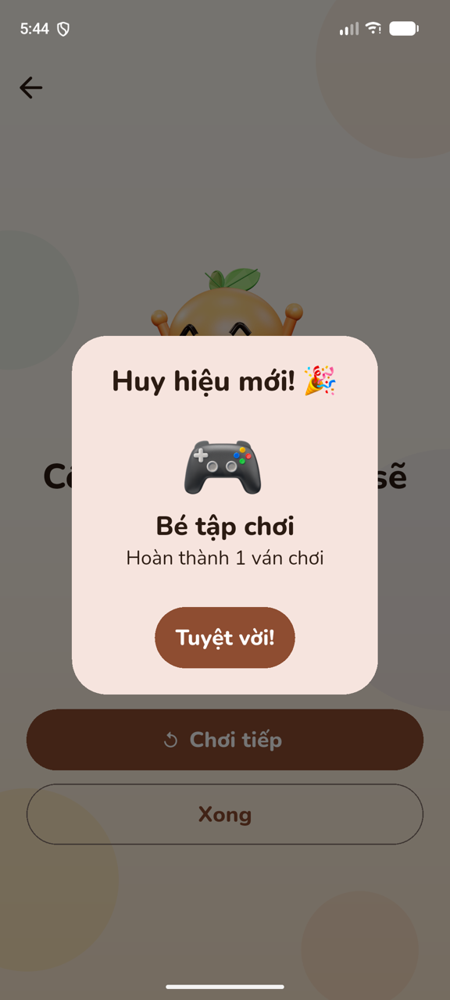 | 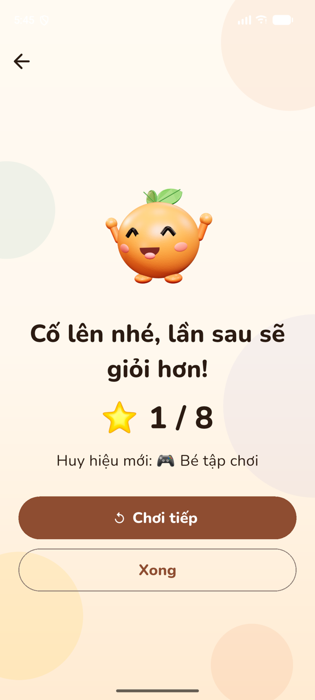 | 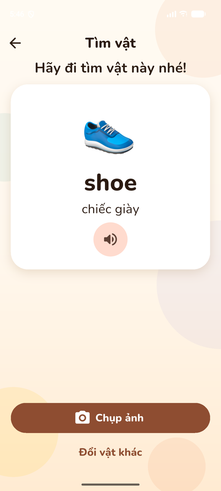 |

| 3.10 Tìm vật: chưa chắc | 3.11 Tìm vật: bố mẹ xác nhận |
|:-:|:-:|
| 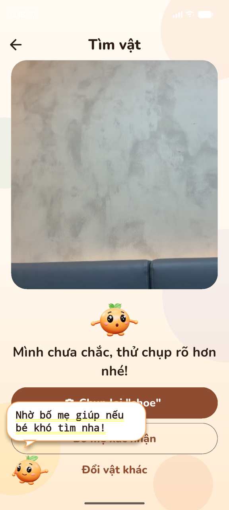 | 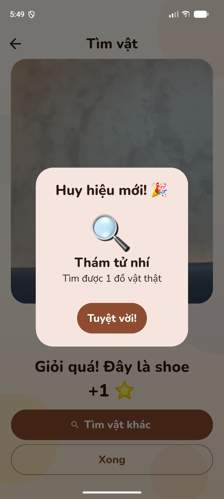 |

| Bước | Kết quả mong đợi | Kết quả thực tế |
|---|---|---|
| Home sau khi vào chế độ bé | Hiện tên + avatar bé, sao, số từ đã học | Đạt: "Bi", 0 sao, 0/60 từ (3.1) |
| Từ vựng → mở từ → *Nghe*, *Nghe câu ví dụ* | Hiện phiên âm, nghĩa, ví dụ; phát âm | Đạt, log không có lỗi |
| *Mình đã học từ này* | Từ vựng 1/60 | Đạt |
| Nghe & chọn hình, chọn sai | Cam động viên, **không trừ sao** | Đạt: "Chưa đúng, thử lại nhé!" (3.6) |
| Hết ván 8 câu | Số sao = số câu đúng ngay lần đầu | Đạt: chọn đúng ngay lần đầu 1 câu → "⭐ 1 / 8" (3.8) |
| Xong ván đầu | Mở huy hiệu "Bé tập chơi" (huy hiệu do server tính) | Đạt (3.7) |
| Tìm vật, chụp ảnh không phải vật cần tìm | "Mình chưa chắc…", cho chụp lại hoặc bố mẹ xác nhận | Đạt (3.10) |
| Bố mẹ xác nhận "Đúng rồi" | +1 sao, mở huy hiệu "Thám tử nhí" | Đạt (3.11) |

## 4. Giới hạn thời gian được thực thi

Giới hạn 5 phút bắt đầu đếm từ lúc vào chế độ bé (17:40). Đến 17:45, **đang giữa lúc hiện hộp thoại huy hiệu**, app tự phủ màn khoá. Bố mẹ giải phép nhân rồi chọn cho chơi thêm.

| 4.1 Hết giờ chơi | 4.2 Bố mẹ chọn số phút | 4.3 Mở khoá |
|:-:|:-:|:-:|
| 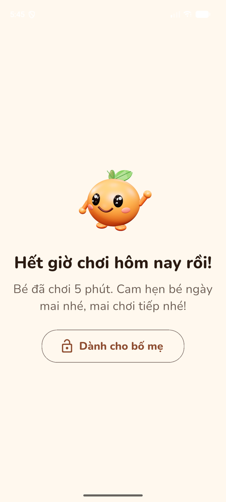 | 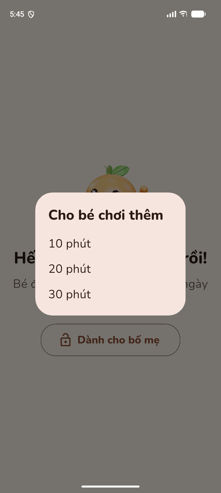 | 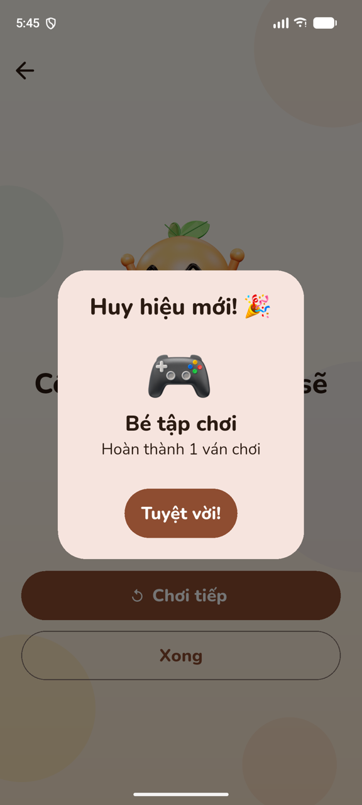 |

| Bước | Kết quả mong đợi | Kết quả thực tế |
|---|---|---|
| Dùng đủ 5 phút | Khoá đúng lúc, che mọi màn kể cả hộp thoại đang mở | Đạt (17:45) |
| Bấm "Dành cho bố mẹ" | Hiện phép nhân; hộp thoại phải nằm **trên** màn khoá | Đạt, gõ đáp án `7 × 9 = 63` |
| Chọn "10 phút" | Mở khoá, bé chơi tiếp được | Đạt (4.3) |
| Dashboard phụ huynh sau đó | "Vượt giới hạn 5 phút" vì bố mẹ đã cho chơi thêm | Đạt (xem 6.1) |

## 5. Cài đặt (sau cổng phụ huynh)

| 5.1 Cài đặt | 5.2 Tắt nhạc / tắt Cam | 5.3 Cập nhật từ vựng | 5.4 Xem lại hướng dẫn |
|:-:|:-:|:-:|:-:|
| 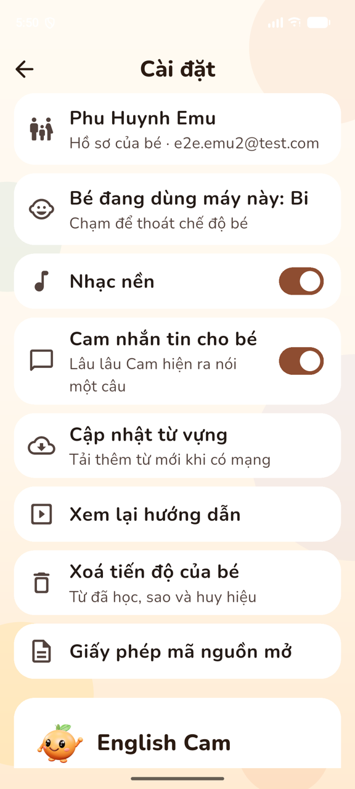 | 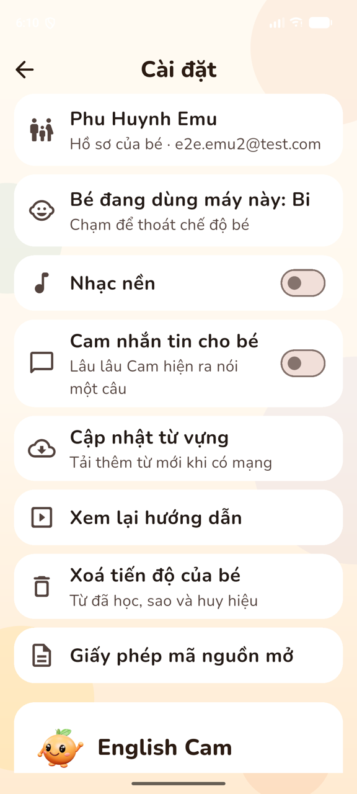 | 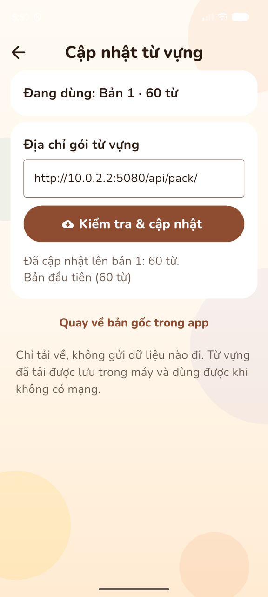 | 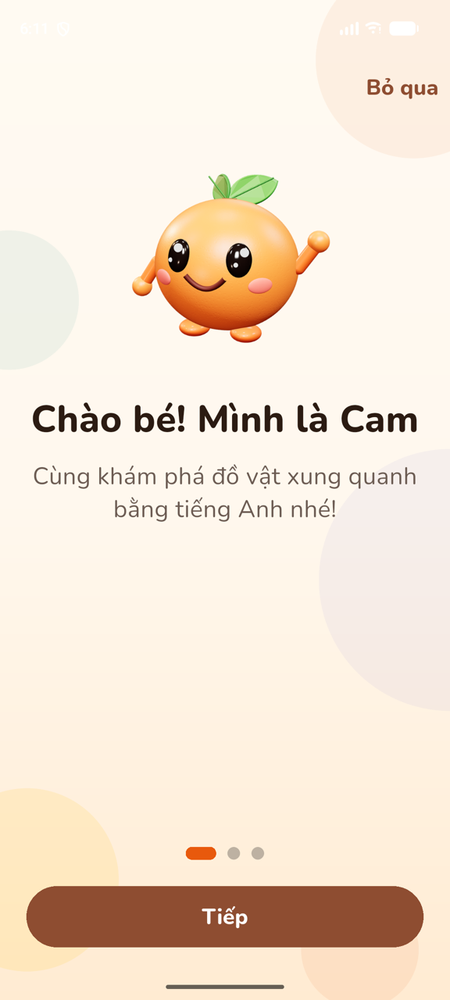 |

| Bước | Kết quả thực tế |
|---|---|
| Vào Cài đặt bằng phép nhân | Đạt; hiện tài khoản phụ huynh và "Bé đang dùng máy này: Bi" |
| Tắt *Nhạc nền* và *Cam nhắn tin* | Đạt, hai công tắc chuyển trạng thái tắt (5.2) |
| *Cập nhật từ vựng* (tải gói từ API) | Đạt: từ "Bản đóng gói sẵn · 60 từ" sang "Bản 1 · 60 từ" tải từ `/api/pack/` (5.3). Đây là lần chạy đầu, khi vẫn phải đặt `PACK_URL`; từ đó đã bỏ yêu cầu này, xem mục 5b |
| *Xem lại hướng dẫn* | Đạt, chạy lại 3 bước giới thiệu (5.4) |
| *Xoá tiến độ của bé* | Đạt: Home về "0 sao · 0/60 từ"; **DB phía server cũng về 0 sao, 0 từ đã học, 0 ván** |

## 5b. Tự báo khi có từ vựng mới (không phải nhập link)

Khi Admin xuất bản một phiên bản từ vựng mới, máy tự biết và báo; bố mẹ chỉ bấm một nút. App chạy **không có `PACK_URL`**.

| 5b.1 Thông báo tự hiện | 5b.2 Màn cập nhật: một nút | 5b.3 Sau khi cập nhật |
|:-:|:-:|:-:|
| 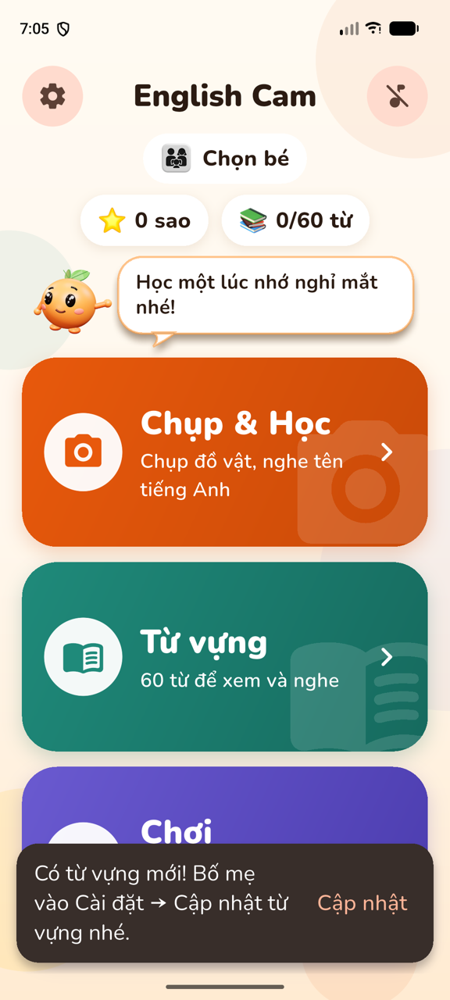 | 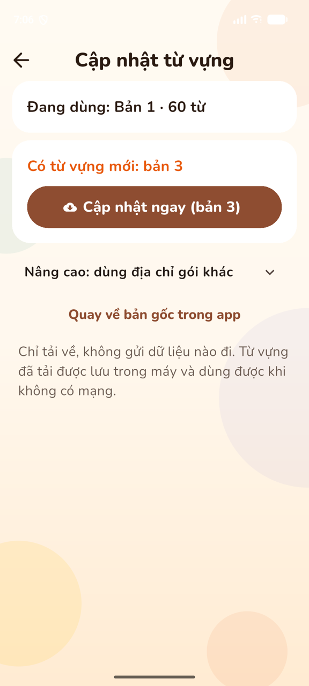 | 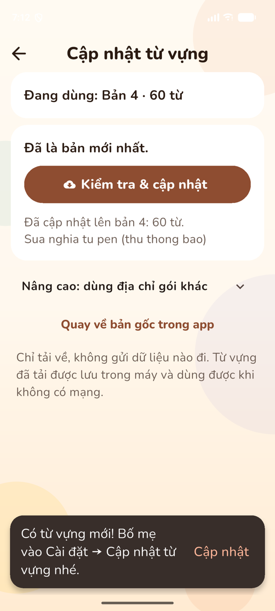 |

| Bước | Kết quả thực tế |
|---|---|
| Backend đang ở bản 3, máy đang dùng bản 1; mở app | Sau vài giây tự hiện "Có từ vựng mới! Bố mẹ vào Cài đặt → Cập nhật từ vựng nhé." kèm nút *Cập nhật* (5b.1) |
| Bấm *Cập nhật* | Hỏi phép nhân (bé không tự cập nhật được), rồi mở màn cập nhật: **không có ô nhập link**, chỉ "Có từ vựng mới: bản 3" và nút **Cập nhật ngay (bản 3)** (5b.2). Ô địa chỉ nằm trong mục "Nâng cao" thu gọn |
| Bấm *Cập nhật ngay* | "Đang dùng: Bản 3 · 60 từ" (5b.3) |
| Admin xuất bản bản 4 (sửa nghĩa từ `pen`, ghi chú "Sua nghia tu pen") **khi app đang ở nền**; 5 phút sau mở lại app | Thông báo hiện ngay lúc quay lại; màn cập nhật tự đổi sang "Có từ vựng mới: bản 4" kèm ghi chú và nút "Cập nhật ngay (bản 4)" |
| Bấm nút | "Đang dùng: Bản 4"; trong *Từ vựng* hiện "pen, cây bút (moi)" |
| Khôi phục từ `pen` và xuất bản bản 5 | Nội dung trên backend về như ban đầu |

Giới hạn: đây là thông báo **trong app** (app đang mở hoặc vừa mở lại). Báo cho máy khi app đã tắt hẳn cần push của hệ điều hành (FCM/APNs), chưa làm.

## 5c. Ảnh thật thay cho emoji ở từ vựng

60 ảnh do nhóm cung cấp (Google Drive, 3 thư mục) được chuẩn hoá thành WebP vuông và gắn theo mã từ. Từ chưa có ảnh vẫn dùng emoji.

| 5c.1 Danh sách từ vựng và chip chủ đề | 5c.2 Game Nghe & chọn hình |
|:-:|:-:|
| 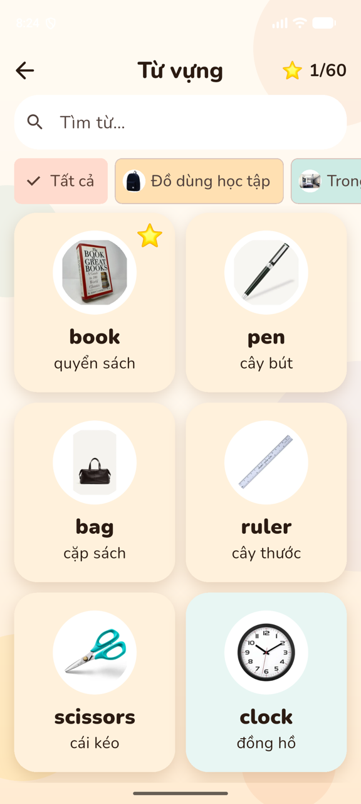 | 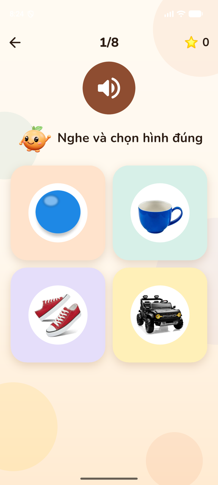 |

| Hạng mục | Kết quả |
|---|---|
| Ảnh đã gắn | **Cả 60 từ**: 56 ảnh theo mã từ (45 ảnh bộ đầu + 9 ảnh bộ bổ sung trong thư mục "bosung" + 2 ảnh chủ đề dùng cho `apple`, `shoe`) và 4 ảnh viên bi màu có sẵn; 11 chủ đề (chip lọc có ảnh đại diện) |
| Chưa có ảnh (dùng emoji) | Không còn từ nào; emoji chỉ là dự phòng cho từ mới của gói cập nhật |
| Không dùng | 4 ảnh màu `red, green, blue, yellow` của bộ mới (mảng màu phẳng, ảnh vàng dính watermark "Vecteezy") |
| Dung lượng | khoảng 1,1 MB cho toàn bộ ảnh |

## 5d. Góp ý khi nhận diện sai ("Khác…" và lời cảm ơn)

Ở màn kết quả, "Không đúng?" mở ba gợi ý của model và thêm lựa chọn **"Khác…"** để gõ tên đúng. Mọi lựa chọn được lưu trên máy rồi gửi lên backend; app cảm ơn người dùng. Backend chỉ nhận chữ (nhãn model đoán, xác suất, top-3, từ đúng), **không có ảnh**.

| 5d.1 Gõ từ app chưa có, app cảm ơn | 5d.2 Admin xem tổng hợp góp ý |
|:-:|:-:|
| 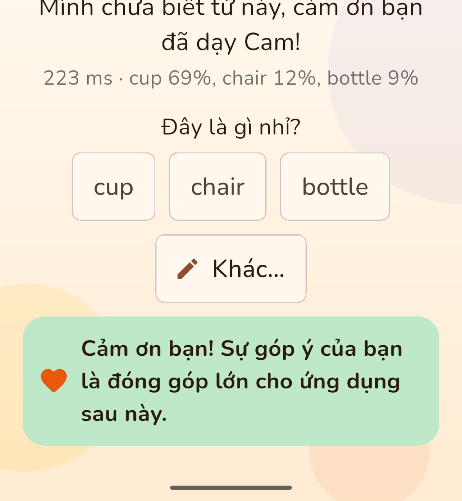 | 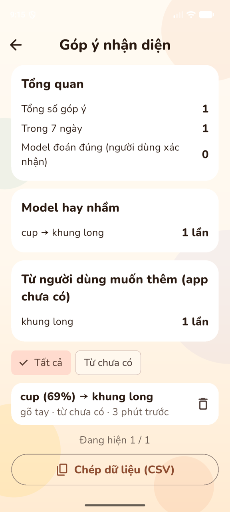 |

| Bước | Kết quả thực tế (backend local, Pixel 7) |
|---|---|
| Chụp, model trả "chưa chắc" (cup 69%), bấm "Không đúng?" | Hiện 3 gợi ý cup / chair / bottle và chip **Khác…** |
| Chọn `cup` (xác nhận model đoán đúng) | Hiện lời cảm ơn; backend nhận một dòng: đoán `cup` 0,6867, đúng `cup`, nguồn `top3`, mô hình `bundled`, phiên bản từ vựng 1, kèm 3 ứng viên |
| Đổi sang `chair` trên cùng ảnh | **Cập nhật cùng một dòng** (cùng thời điểm tạo, chỉ đổi từ đúng); tổng vẫn 1 |
| Khác… → gõ "cai ban" (không dấu) | Gợi ý "table · cái bàn"; gửi thì hiện từ `table`, ghi `typed`, mã từ `table` |
| Khác… → gõ "khung long" (app chưa có) | Hiện "Mình chưa biết từ này, cảm ơn bạn đã dạy Cam!", ghi `typed`, mã từ rỗng |
| Admin → Góp ý nhận diện | Tổng quan, cặp "cup → khung long" và danh sách từ người dùng muốn thêm (5d.2) |
| Xuất CSV | Phát hiện lỗi thật: cột xác suất in `0,6867` (dấu phẩy theo ngôn ngữ máy) làm lệch cột; đã sửa bằng `InvariantCulture` + test ép vi-VN |
| Thông báo "có từ vựng mới" | Phát hiện lỗi thật: nằm đè nút chụp ảnh và không tự ẩn (SnackBar có nút mặc định `persist: true`); đã nâng lên khỏi vùng đáy và đặt `persist: false` |

## 6. Dashboard phụ huynh

Từ Cài đặt → tài khoản phụ huynh → **Tiến độ** của bé. Số liệu lấy từ máy chủ (tính ở server).

| 6.1 Tóm tắt | 6.2 Theo chủ đề | 6.3 Huy hiệu, hoạt động, xuất CSV |
|:-:|:-:|:-:|
|  | 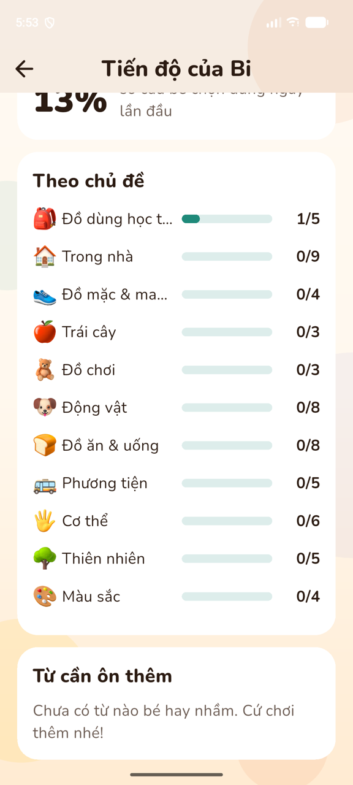 | 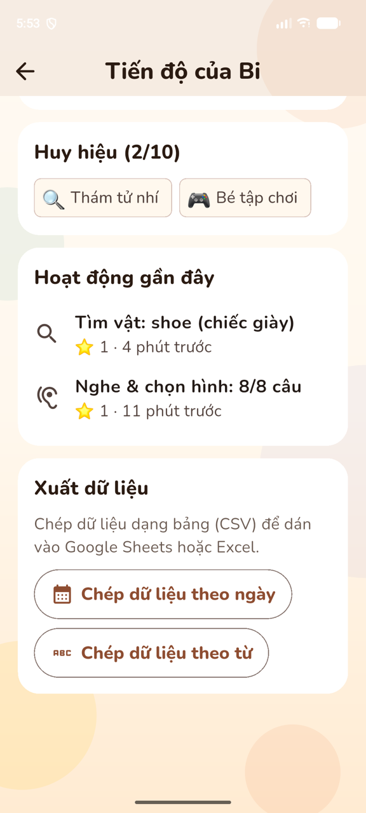 |

Đối chiếu với những gì bé thực sự đã chơi:

| Chỉ số | Đã làm | Dashboard |
|---|---|---|
| Từ đã học | 1 | 1/60 |
| Sao | 1 (ván chọn hình) + 1 (Tìm vật do bố mẹ xác nhận) | 2 |
| Ván | 1 | 1 ván · 0 hoàn hảo |
| Độ chính xác | 1 câu đúng ngay lần đầu / 8 | 13% (1/8) |
| Huy hiệu | Bé tập chơi, Thám tử nhí | 2/10 |
| Chuỗi ngày | chơi hôm nay | 1 ngày |
| Hoạt động gần đây | 2 mục | "Tìm vật: shoe" và "Nghe & chọn hình: 8/8 câu" |

Nút *Chép dữ liệu theo từ/ngày* báo "Đã chép dữ liệu. Dán vào Google Sheets hoặc Excel nhé."

## 7. Bé dùng nhiều máy (mã liên kết)

Phụ huynh bấm **Quản lý → Thêm máy cho bé** để lấy mã 8 số (sống 10 phút, dùng một lần), sau đó đăng xuất; máy ảo đóng vai "máy thứ hai" và nhập mã ở cổng.

| 7.1 Mã liên kết | 7.2 Đăng xuất → về cổng | 7.3 Máy mới liên kết xong |
|:-:|:-:|:-:|
| 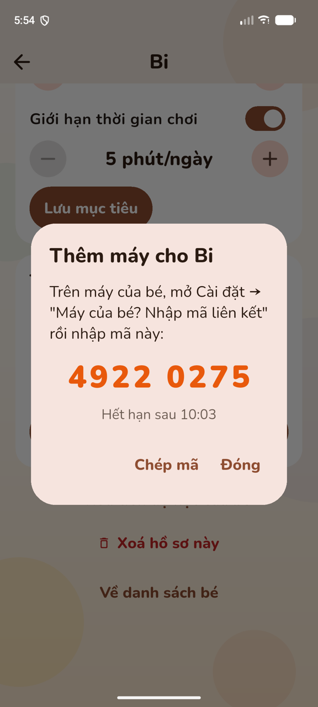 | 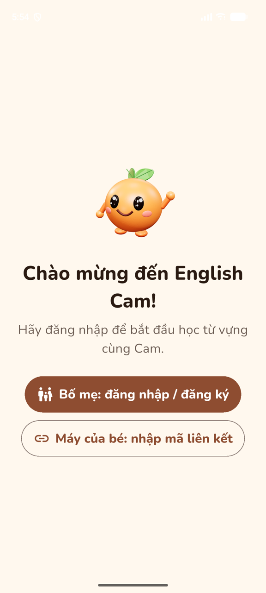 |  |

Kết quả: nhập mã `6624 4095` ở "Máy của bé" thì vào thẳng Home của Bi và **nhận lại đủ tiến độ từ máy chủ** (2 sao, 1/60 từ) dù đây là một phiên mới. Đăng xuất phụ huynh cũng thu hồi phiên của máy bé trên máy đó (thẻ bé hiện "0 thiết bị").

## 8. Khu quản trị (tài khoản Admin)

Đăng nhập `admin@englishcam.local` (tài khoản seed của backend dev) rồi OTP → vào thẳng trang **Quản trị**.

| 8.1 Số liệu hệ thống | 8.2 Người dùng | 8.3 Khoá tài khoản |
|:-:|:-:|:-:|
| 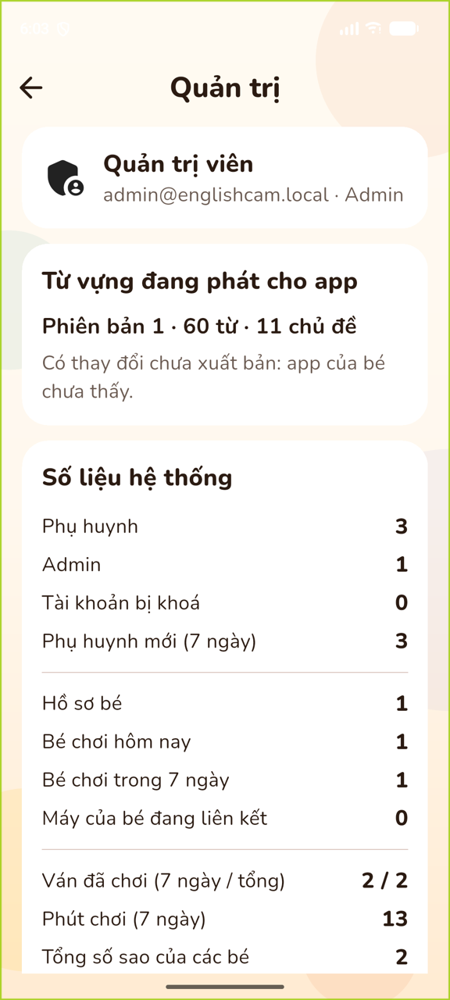 | 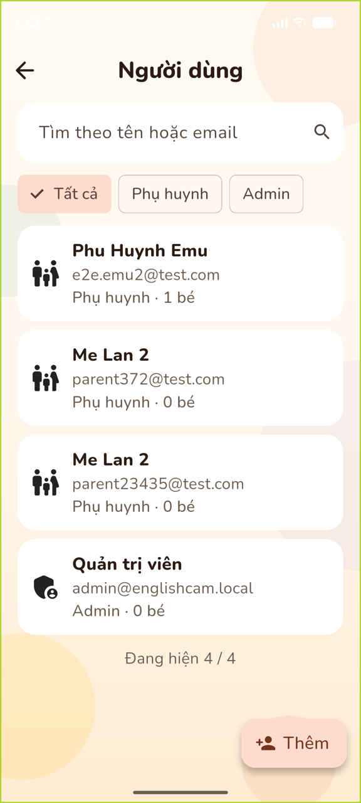 | 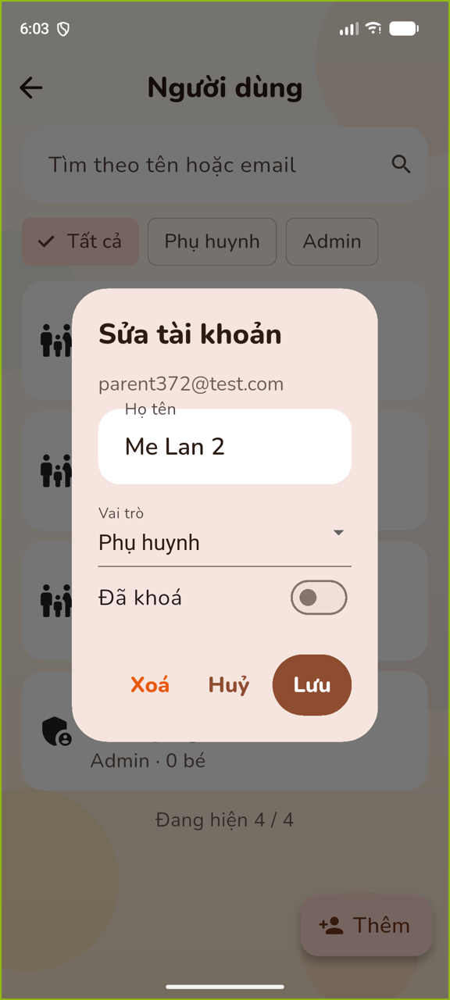 |

| 8.4 Từ vựng | 8.5 Sửa từ | 8.6 Đã xuất bản | 8.7 Chủ đề |
|:-:|:-:|:-:|:-:|
| 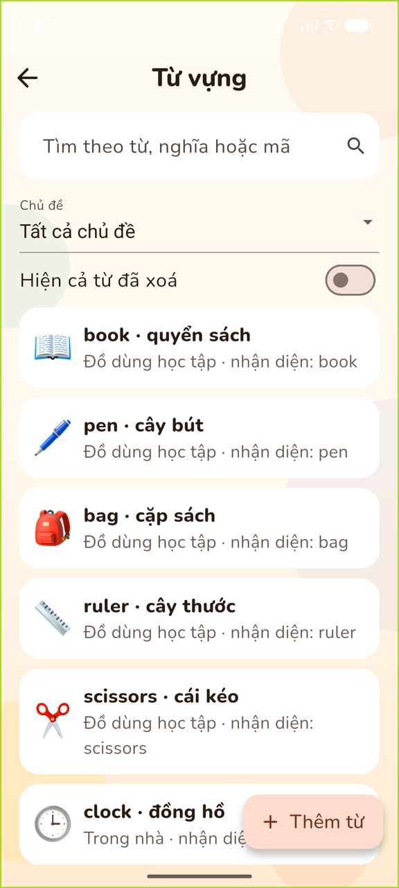 | 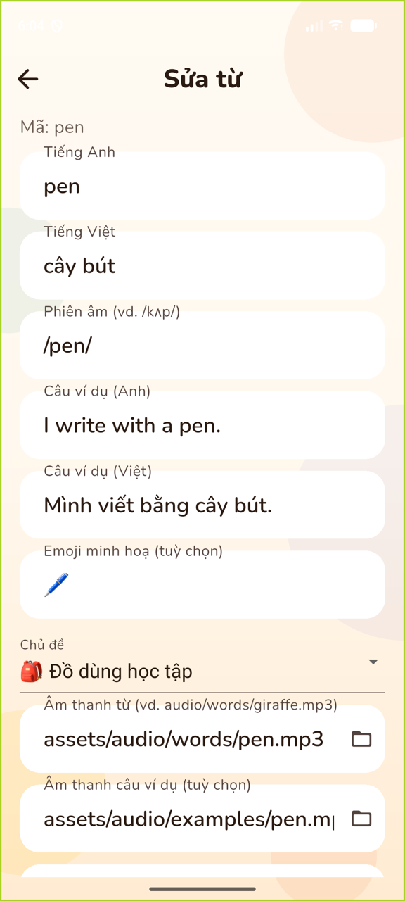 | 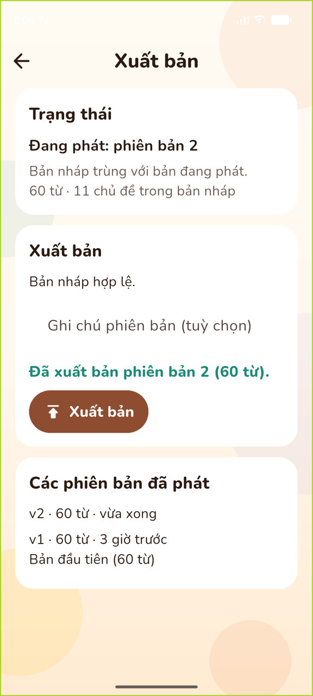 | 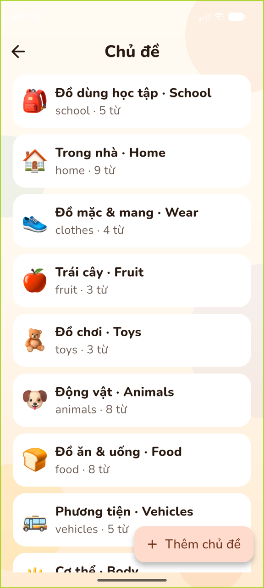 |

| Bước | Kết quả thực tế |
|---|---|
| Số liệu hệ thống | Đạt: khớp lượt chơi vừa làm (2 ván, 13 phút, 2 sao, 1 bé hoạt động hôm nay) |
| Khoá một phụ huynh | Đạt: dòng hiện "ĐÃ KHOÁ"; mở khoá lại cũng được |
| Sửa nghĩa từ `pen` thành "cây bút thu" → lưu | Đạt; danh sách cập nhật ngay, trang quản trị báo "có thay đổi chưa xuất bản" |
| *Xuất bản cho app* → xác nhận | Đạt: phiên bản 1 → **2**; `GET /api/vocab` trả "cây bút thu" |
| Hoàn lại từ và xuất bản lần nữa | Đạt: phiên bản 3 có nội dung như bản đầu |
| Chủ đề | Đạt: 11 chủ đề kèm số từ |

Sau kịch bản, tôi đã xoá các tài khoản thử và hoàn tác dữ liệu (xem mục 11).

---

## 9. Chưa kiểm chứng được

| Hạng mục | Lý do |
|---|---|
| **Đăng nhập Google** | Bấm nút hiện hộp chọn tài khoản Google của máy ảo (cấu hình client hoạt động đến bước này), nhưng **không chọn tài khoản** vì đó là tài khoản cá nhân. Backend local cũng chưa có `Google:ClientId`. |
| **OTP qua email thật** | Với backend local thì mã in ra log. Trên **bản deploy đã kiểm chứng**: email chứa mã tới hộp thư thật (mục 13). |
| **Máy Android thật** | Chỉ chạy trên máy ảo. Hiệu năng nhận diện thật (275 ms trên máy ảo) cần đo lại trên máy thật. |
| **Nhận diện đúng vật** | Camera máy ảo là webcam của Mac: ảnh bức tường bị trả "chưa chắc" (đúng), khuôn mặt bị đoán "hat 81%" vì model **không có lớp "người"** (giới hạn đã biết của model, nút "Không đúng?" cho chọn lại trong top-3). Chưa thử đưa đồ vật thật trước webcam. |
| **iPhone** | Đã thêm nền tảng iOS và nâng thư viện TFLite iOS lên 2.17.0 (xem tài liệu hướng dẫn gốc của dự án); đã xác nhận model nạp được, chưa test tay vì từ xa không chụp được màn hình iPhone. Bản iPhone hiện cài **chưa có** cổng đăng nhập mới. |
| Âm thanh | Chỉ kiểm tra lệnh phát không lỗi, không nghe được tiếng trong máy ảo. |

## 10. Lỗi tìm thấy khi chạy demo và đã sửa

Chạy thật trên máy ảo lộ ra các lỗi mà test tự động (widget test) không thấy; mỗi lỗi đã sửa kèm test hồi quy.

| # | Lỗi | Cách phát hiện | Cách sửa |
|---|---|---|---|
| 1 | Màn đăng nhập trong cổng có nền trong suốt nên **Home bên dưới lộ xuyên qua** form | Ảnh chụp màn hình đăng ký (chữ "English Cam", "0 sao" chồng lên form) | Bọc Navigator của cổng trong `FunBackground` (nền đặc) |
| 2 | Nút **Back của Android trong cổng thoát luôn app** thay vì lùi một màn | Bấm Back ở màn nhập mã, app biến mất về màn hình chính | `BackInterceptor` đăng ký trước `WidgetsApp`, chuyển Back vào Navigator của cổng và màn khoá |
| 3 | Sau khi đăng nhập, phụ huynh **không được đưa tới trang của mình** (ở lại Home) | Test `auth_gate_test` đỏ trước khi chạy máy ảo | Biến `late bool _wasGuest` khởi tạo muộn, đổi sang đọc trong `initState` |
| 4 | Chữ trong bong bóng lời nhắn của Cam đổi sang font mặc định (và gạch chân vàng ở bản debug) khi nằm ngoài `Scaffold` | Ảnh chụp màn Tìm vật | Bọc `SpeechBubble` trong `Material` trong suốt |
| 5 | Bong bóng của Cam che nút "Chụp ảnh" của màn Tìm vật trong vài giây | Cú bấm của kịch bản trúng bong bóng | **Chưa sửa** (hành vi thiết kế: Cam hiện 7 giây); nên cân nhắc đẩy bong bóng lên cao hơn |
| 6 | Hướng dẫn "Cài đặt → Máy của bé? Nhập mã…" và hộp thoại đăng xuất nói "chế độ khách" đã **lỗi thời** sau khi bắt buộc đăng nhập | Đọc ảnh hộp thoại mã liên kết và đăng xuất | Sửa câu chữ trong app |

### Quan sát khác (chưa sửa, cần bạn quyết định)

- **"Bố mẹ xác nhận" (Tìm vật) không qua cổng phép nhân**, chỉ hỏi "Đúng rồi/Chưa": bé tự bấm được để lấy 1 sao.
- Màu chữ trên thanh trạng thái (giờ, pin) gần như **trắng trên nền kem**, khó đọc ở mọi màn (thấy rõ ở ảnh 1.1 và 3.1).
- Địa chỉ email dài bị ngắt giữa chữ ở thẻ phụ huynh trong "Hồ sơ của bé".
- Màn khoá hết giờ vẫn ghi "Dành cho bố mẹ" ở hộp phép nhân là "…để vào Cài đặt".
- Admin đăng xuất không hỏi xác nhận (phụ huynh thì có).

## 11. Dọn dẹp sau demo

- Đã xoá tài khoản thử `e2e.emu*` và hồ sơ bé qua API Admin; số liệu hệ thống về 2 phụ huynh, 0 bé.
- Dữ liệu từ vựng đã hoàn lại nội dung ban đầu, nhưng DB dev còn thêm **bốn phiên bản phát hành** (v2 đến v5) do thử xuất bản (v4 có nghĩa `pen` bị đổi, v5 đã hoàn lại).
- Đã xoá các ảnh chụp có hình khuôn mặt (webcam của Mac) khỏi bộ ảnh demo.

## 12. Kiểm thử tự động đi kèm

| Bộ test | Kết quả |
|---|---|
| `flutter test` (app) | **299 test đạt**, `flutter analyze` sạch |
| `dotnet test` (backend) | **149 test đạt** (chạy API thật trên SQL Server Docker) |
| Test mới trong đợt này | Cổng đăng nhập (8), giới hạn thời gian (15 + nhóm 8 test trong `sync_service_test`), khu quản trị (18), bong bóng Cam (1), theo dõi từ vựng mới + màn cập nhật một nút (27) |

---

## 13. Chạy lại trên URL deploy (không dùng localhost)

Cùng app, **không truyền `API_URL`** nên dùng địa chỉ mặc định `https://vuclaude309gmai-001-site1.etempurl.com` (SmarterASP.NET, SQL Server thật, https). Tài khoản thử được đăng ký bằng một địa chỉ Gmail thật; mã OTP là email gửi từ chính backend trên host (người dùng đọc từ hộp thư rồi nhập). Phạm vi: phụ huynh và bé; **không** chạy khu Admin trên host (cần tài khoản Admin của host).

| 13.1 Giới hạn 5 phút/ngày | 13.2 Home của bé | 13.3 Huy hiệu sau ván đầu | 13.4 Hết giờ |
|:-:|:-:|:-:|:-:|
| 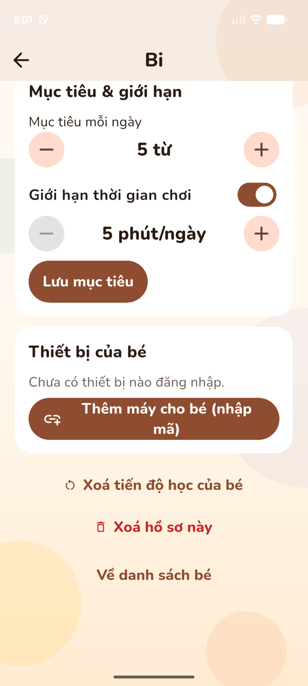 |  | 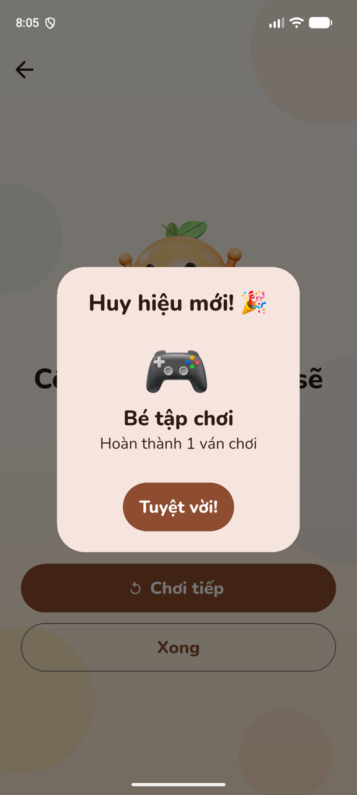 | 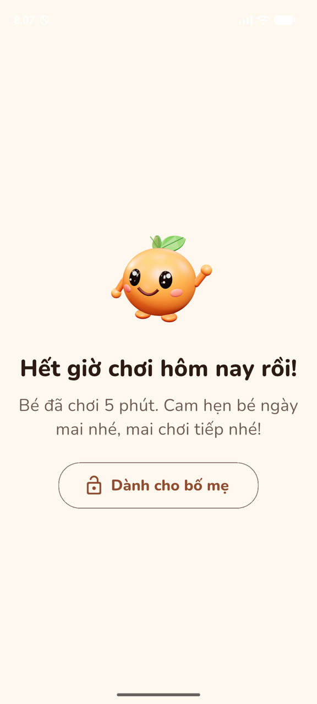 |

| 13.5 Cập nhật từ vựng (không nhập link) | 13.6 Dashboard phụ huynh | 13.7 Máy thứ hai nhận tiến độ |
|:-:|:-:|:-:|
| 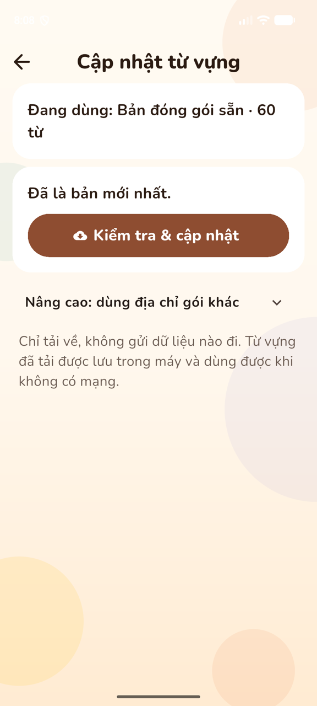 | 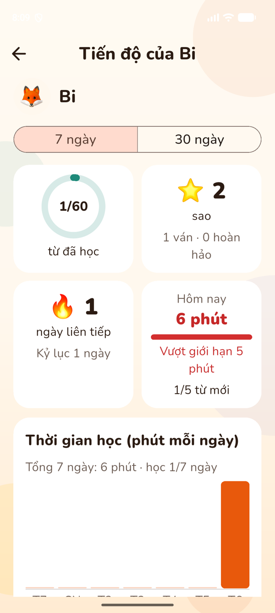 |  |

| Bước | Kết quả trên host |
|---|---|
| Mở backend lần đầu sau thời gian nhàn rỗi | `GET /health` mất **11,5 giây** (host "ngủ"), sau đó dưới 1 giây |
| Đăng ký tài khoản phụ huynh | Backend gửi email mã xác minh tới hộp thư thật; từ máy ảo mất khoảng 6 giây khi host đã ấm. (Gọi trực tiếp bằng curl: 4,7 giây.) |
| Nhập OTP | Đạt, vào "Hồ sơ của bé" |
| Tạo bé, đặt giới hạn 5 phút | Đạt: "Đã lưu mục tiêu và giới hạn." (13.1) |
| Vào chế độ bé, học 1 từ, chơi 1 ván 8 câu | Đạt: nhận huy hiệu "Bé tập chơi" (13.3), "⭐ 1 / 8" |
| Tìm vật: app xin quyền camera lần đầu | Hiện hộp xin quyền, chọn "While using the app" rồi chụp được; bố mẹ xác nhận → huy hiệu "Thám tử nhí" |
| Hết 5 phút | App tự khoá lúc **20:07:21**, đúng 5 phút sau khi vào chế độ bé (20:02:16); bố mẹ mở khoá bằng phép nhân + "10 phút" (13.4) |
| Cài đặt → Cập nhật từ vựng, không nhập gì | Mở màn là tự kiểm tra: "Đã là bản mới nhất."; bấm nút tải gói từ host: "Bản 1 · 60 từ" (13.5) |
| Dashboard phụ huynh | Đạt, khớp với những gì bé đã chơi: 1/60 từ, 2 sao, 1 ván, chuỗi 1 ngày, 6 phút (13.6) |
| Tạo mã liên kết, đăng xuất phụ huynh, nhập mã trên "máy mới" | Đạt: Home của bé hiện **2 sao, 1/60 từ** lấy từ máy chủ (13.7) |

### Điều học được khi chạy trên host
1. **Hai lần "Không kết nối được máy chủ" đầu tiên không phải do backend:** máy ảo bị mất DNS (không phân giải được cả `google.com`); khởi động lại máy ảo với `-dns-server 8.8.8.8` là chạy. Tôi từng nghi nhầm do SMTP chậm; gọi `register` bằng curl chỉ mất 4,7 giây nên loại trừ.
2. **Mã OTP cũ mất hiệu lực khi gửi mã mới:** mỗi lần bấm Đăng ký/Gửi lại tạo mã mới và thay mã trước, nên người dùng phải nhập mã trong email **mới nhất**. Nên nói rõ điều này trên màn OTP.
3. **Backend gửi email ngay trong yêu cầu đăng ký** và `EmailService` không đặt thời gian chờ SMTP (MailKit mặc định 2 phút). Hiện chưa gặp lỗi, nhưng nếu SMTP chậm thì app (chờ 45 giây) báo mất kết nối. Nên đặt timeout hoặc gửi nền.
4. **Host "ngủ"** mất khoảng 11 giây ở yêu cầu đầu, app chịu được (timeout 30 đến 45 giây).

### Góp ý nhận diện sai trên host (21:42 đến 21:50)

Bản `publish/` mới (có endpoint góp ý) đã được upload; Swagger trên host có 56 đường dẫn, 4 endpoint góp ý trả 401 khi không kèm token. Đăng nhập lại tài khoản thử bằng OTP thật (email gửi lúc 21:42, nhập 21:44), vào chế độ bé, chụp một ảnh (model đoán `bottle` 100%, sai) rồi sửa bốn lần trên **cùng một ảnh**:

| Lần | Lựa chọn | Hàng đợi trên máy sau ~5 giây |
|---|---|---|
| 1 | chọn gợi ý `cup` | rỗng (máy chủ đã nhận) |
| 2 | đổi sang gợi ý `toothbrush` | có 1 mục ngay lúc chọn, rồi rỗng |
| 3 | "Khác…" gõ "cai ban" (không dấu) | hiện từ `table`, hàng đợi rỗng |
| 4 | "Khác…" gõ "khung long" (app chưa có) | hiện "Mình chưa biết từ này…", hàng đợi rỗng |

Không có dòng log từ chối hay lỗi nào; `/health` vẫn `connected` sau đó, nên bảng `RecognitionFeedback` và migration đã chạy trên host (nếu bảng thiếu thì máy chủ trả 500 và hàng đợi sẽ còn mục). **Chưa đọc được dữ liệu góp ý phía máy chủ** vì cần tài khoản Admin của host (bạn chọn không chạy Admin trên host). Cuối cùng đã xoá hồ sơ bé thử (xoá luôn góp ý của bé trên host); tài khoản phụ huynh của chủ dự án vẫn còn.

Phát hiện thêm: ô nhập OTP trên Android bị gợi ý tự điền qua SMS của Google ("Waiting for message") che mất, phải bấm CANCEL mới nhập được. Đây là hành vi của hệ điều hành với trường OTP; có thể bỏ gợi ý đó nếu thấy phiền.

### Dữ liệu thử còn lại trên host
Một tài khoản phụ huynh (xác minh bằng Gmail của chủ dự án), không còn hồ sơ bé nào (đã xoá). Không xuất bản phiên bản từ vựng nào. Xoá tài khoản cần Admin.

